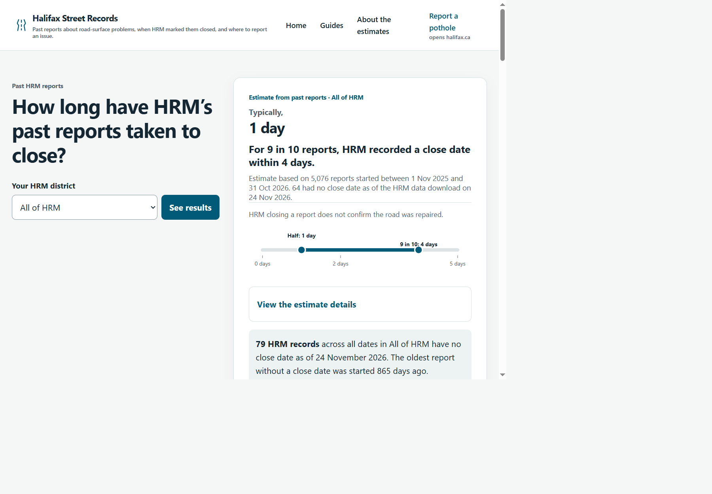
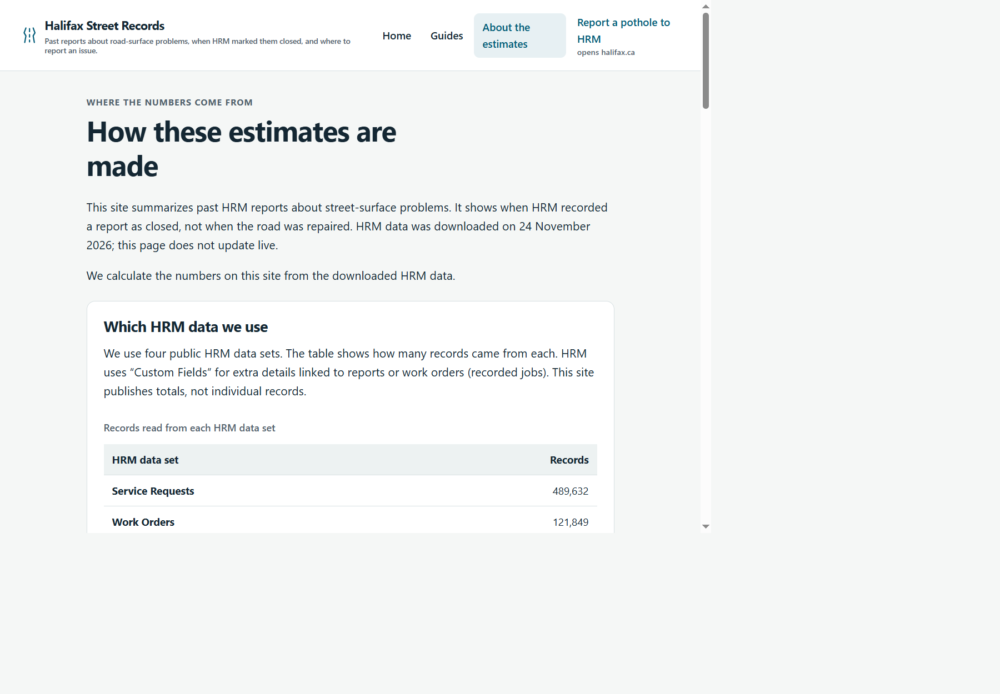

# Halifax Street Records

A resident-focused summary of past HRM “Street Surface Maintenance” reports: how long HRM took to record a close date, how many records have no close date, and when reports came in.

## The question and current answer

**How long have HRM’s past reports taken to close?**

For All of HRM, the estimated typical time by which HRM had recorded a close date for about half of past reports is **1 calendar day**. For about 9 in 10 reports, it is **4 days** (n = 5,076 reports started from November 1, 2025 to October 31, 2026).

This snapshot uses HRM data downloaded on **November 24, 2026**. A recorded close date does not confirm that a repair was completed. Reports without a close date are counted only up to the download date; these past records cannot predict when an individual report will close.

## Key findings and limits

- The selected HRM category is broader than potholes. The data scan found 17,210 matching Service Requests across 10 calendar years.
- A separate all-date count shows 79 records had no close date as of the download date; the oldest was started 865 days earlier. A missing close date does not prove that a road problem is still present.
- The available data does not reliably link a report to the work done on the road, and it does not identify pothole dimensions or road class. This project cannot determine whether HRM met its pothole repair standard.

## What the site includes

- The All of HRM summary and one page for each of the 16 numeric district codes.
- Past recorded closure-time estimates, with the sample size and date range.
- Counts and age groups for HRM records with no close date, plus monthly and weekly report counts.
- Sourced guides on reporting a road problem, who maintains a road, and what to do after vehicle damage.
- A plain-language explanation of the data, methods, and limits.

The site is a static snapshot, not an HRM service, a live feed, or an individual request tracker. It is an independent project and is not run by HRM.

## Screenshots





## Data source and attribution

The pipeline uses four public HRM Cityworks data sources: [Service Requests](https://services2.arcgis.com/11XBiaBYA9Ep0yNJ/arcgis/rest/services/Cityworks_Service_Requests/FeatureServer/0), [Work Orders](https://services2.arcgis.com/11XBiaBYA9Ep0yNJ/arcgis/rest/services/Cityworks_Work_Orders/FeatureServer/0), [Work Orders Custom Fields](https://services2.arcgis.com/11XBiaBYA9Ep0yNJ/arcgis/rest/services/Cityworks_Work_Orders_Custom_Fields/FeatureServer/0), and [Service Requests Custom Fields](https://services2.arcgis.com/11XBiaBYA9Ep0yNJ/arcgis/rest/services/Cityworks_Service_Requests_Custom_Fields/FeatureServer/0).

Contains information licenced under the Open Government Licence—Halifax.

## Method in brief

The pipeline selects the “Street Surface Maintenance” category, converts report and close timestamps to Halifax time, and counts calendar days between the two dates. It estimates the typical and 9-in-10 recorded closure times, including reports that have no close date yet by counting only up to the data download date. District estimates are shown only with at least 30 reports; smaller samples use the All of HRM estimate. The site counts report volume by the report’s start date.

See [the requirements](project/requirements.md), [definitions](project/definitions.md), and [data reconciliation](project/reconciliation.md) for further detail.

## Reproduce

Requirements: Python 3.10 or newer. Create the local environment and install dependencies from the project root in PowerShell:

```powershell
py -3 -m venv .venv
.\.venv\Scripts\python.exe -m pip install -r python\requirements.txt
```

Run the tests and rebuild the site from the committed aggregate data:

```powershell
.\.venv\Scripts\python.exe -m pytest
.\.venv\Scripts\python.exe python\build_site.py
```

To download current source data from HRM and recalculate the aggregates:

```powershell
.\.venv\Scripts\python.exe python\pipeline.py --refresh
.\.venv\Scripts\python.exe python\build_site.py
```

Raw downloaded records stay in the local, Git-ignored `data/raw/` folder. The pipeline writes aggregate-only JSON to `docs/data/`; it does not publish addresses, coordinates, written comments, names, contact details, or request IDs.

To preview the generated site locally:

```powershell
.\.venv\Scripts\python.exe -m http.server 8000 --directory docs
```

Then open `http://127.0.0.1:8000/`. The site uses static HTML, CSS, inline SVG, and vanilla JavaScript; it does not require a chart library, CDN, or analytics service.
